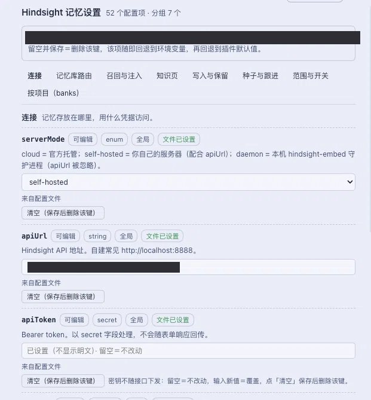

# @Echo-Note/dsh-hindsight-settings

[English](README.md) | 中文


一个 DeepSeek Harness（DSH）配套插件，在 Settings 中新增 **Hindsight 记忆设置** 页面，使得
`~/.hindsight/coding-agent.json` 可以直接在 GUI 里编辑，而不必手工修改。

它是刻意做成配套插件的。`@vectorize-io/hindsight-coding-agents` 以 **子路径行**（`…/coding-agents/dsh`）挂载，而
DSH 的客户端模块系统只会给 specifier 为裸包名的那一行附上浏览器半边 —— 因此该包若不改变每个既有用户的挂载方式，
就无法自带设置页面。它也没有声明任何 `Config`：它不从 dsh 导入任何东西，而是从自己的文件解析设置，
随包发布的设置表单（由 schema 派生、持久化进 profile patch）够不到这个文件。因此本包自带页面和自己的宿主服务，
对该插件不做任何改动。

## 安装

**从 GitHub 安装** —— 该包直接从本仓库消费，它的 `@vectorize-io/hindsight-coding-agents` 依赖会随之安装，
所以一次安装即可得到两者：

```bash
# Any profile except a packaged Desktop one, whose profile the CLI refuses to write:
dsh plugin --profile <profile> add github:Echo-Note/dsh-hindsight-settings
```

在 **桌面应用** 中（即 Electron 外壳所拥有的那个 profile），CLI 按设计会拒绝写入；此时应改从 GUI 安装 ——
**Settings → Plugins → install**，粘贴同一个 spec：

```
github:Echo-Note/dsh-hindsight-settings
```

它解析到的那个 40 字符的 commit 由包管理器的 lockfile 固定，所以之后的一次 `git push` 不会悄悄改变你运行的内容：
要移动它，就重新安装（或更新）。Git 安装不构建任何东西 —— 编译后的 `lib/` 已提交 —— 所以安装是一次检出，
而不是一次构建。

带 scope 命名是可选的。`github:Echo-Note/dsh-hindsight-settings` 会按本包 `package.json` 里的名字安装它；
要强制使用另一个键，就用 npm alias 形式，本仓库自己的 dry-run 用的正是这种：

```bash
dsh plugin --profile <profile> add '@Echo-Note/dsh-hindsight-settings@github:Echo-Note/dsh-hindsight-settings'
```

**从本地检出安装**（在编辑本包期间）：

```bash
git clone https://github.com/Echo-Note/dsh-hindsight-settings.git
cd dsh-hindsight-settings
npm install          # dev dependencies only; nothing is needed at runtime but the peer packages
npm run build        # optional: refreshes lib/ from src/
dsh plugin --profile <profile> add link:"$PWD"
```

`link:`（而不是 `file:`）才是你可能要编辑的包该用的 spec：`file:` 会把快照复制进 profile，`link:` 则做符号链接，
所以重建后的浏览器半边会在下一次页面加载时被采用。

### 唯一需要手动的一步

只有当 profile 在 `dsh.profile.bundles` 里选中某个 bundle 时，包里的 bundle 才会被挂载，
而 dsh 自己的 plugin-manager README 指出 "an unselected plain dependency is left out"（未选中的普通依赖会被略过）
—— 管理器会列出某个依赖提供的 bundle，但不会选中它们。所以在安装本包之后，要在 **Settings → Plugins** 里启用一次
**Hindsight**（按名字安装该 bundle，`dsh plugin --profile <profile> add @vectorize-io/hindsight-coding-agents`，效果相同）。

`dsh` 没有 bundle-depends-on-bundle 字段来表达这件事（`DshManifest` 只携带 `manifestVersion`、`bundle.patch`、
`client`、`engines.dsh`），而另一种做法 —— 由我们的 patch 直接插入 Hindsight 那一行 —— 在它自己的 bundle
也被启用时会重复组合同一行，因为 patch 的 `insert` 追加时不会对 entry id 去重。

宿主半边、`./typert` 清单和浏览器 bundle 都在启动时读取，而 dsh 的插件管理器指出
"package replacements require restarting the process to load a fresh JavaScript module generation"
（替换包需要重启进程才能加载新的 JavaScript 模块代次）—— 所以安装后要 **重启一次**。

## 工作原理

```
~/.hindsight/coding-agent.json          ← the one file every Hindsight harness reads
        ▲            │
        │ apply()    │ describe()                     (host, src/service.ts + src/typert.host.ts)
        │            ▼
   ctx.provide('hindsightSettings')  ──Remote──▶  POST /api/hindsightSettings/<method>
        ▲                                                  │
        └──────────────────────────────────────────────────┘
                                    browser (src/client/index.tsx)
                       page in Settings, mounted via ctx.remote.$mount(contribution)
```

- 宿主发布一个 Cordis 服务；它的 `./typert` 清单把 `describe` 和 `apply` 暴露给页面（`docs/api-gateway.md`）。
- 页面渲染来自 `src/fields.ts` 的每一个字段 —— 配置面的唯一声明 —— 并且只写回发生变化的部分。
  用户清空的字段以 `null` 发送，这会删除该键，于是该项设置回退到环境变量，再回退到插件自身的默认值。
- 字段按分组各占一个标签页，另加一个 **按项目（banks）** 标签页。bank 标签页编辑 `banks.<id>`，
  上游正是靠它让某个仓库与共享的顶层有所不同；打开一个 bank 会调用 `describe({ kind: "bank", id })`，
  保存会调用 `applyScoped(...)`。`paths.<dir>` 只读列出。
- 文件没有设置的字段仍会显示其 **实际生效** 的值 —— 插件默认值 —— 并如此标注，而清空的单元格仍然意味着
  「删除该键」。在单元格真正发生变化之前不会写入任何内容。
- 密钥从不下发给页面：`apiToken` 显示为已设置但空白（「已设置（不显示明文）」），输入会替换它，
  只有显式的 清空 按钮才会移除它。这与 dsh 自己的设置服务一致，那里的 `role('secret')`
  值不会出现在表单响应中。
- 没有任何东西经过 DSH 的设置表单或 profile patch。更早的一个修订试图把该文件镜像进本插件自己的 `Config`，
  好让随包发布的表单把它显示出来；一次真实安装以 _"HMR transactions cannot be nested"_（HMR 事务不能嵌套）
  拒绝了那次写入（该行挂载在加载器的事务内部，是一个连定时器都会继承的 `AsyncLocalStorage` 作用域），
  而表单也从未服务过该命名空间。直接与文件对话既更简单，也是宿主状态的文档化路径。

## 安全

- 只接管受管键：本包不认识的键，以及嵌套的 `banks` / `paths` / `harnesses` 段落，都原样保留。
- `null` 会删除一个键；没有别的删除方式，页面从未发送的字段则不受影响。
- 写入经由临时文件 + rename，权限为 `0600` —— 该文件可能存放 `apiToken`。
- 无法解析的文件 **绝不** 被覆盖：页面会报告它并禁用保存。
- 非法值（类型错误、未知键、仅文件可编辑的嵌套映射）会在磁盘被触碰之前被拒绝。

## 接口字段

`mapPathToBank`、`pages`、`customPages`、`recallOptions`、`retainMetadata`、`defaultBankConfig`、
`harnesses` 以及已废弃的 `autoReflect` 在分组标签页中以 **只读** 显示：它们是单个表单字段无法表达的嵌套映射，
上游把它们记为仅文件可编辑。页面逐字段说明这一点，而不是把它们藏起来。`banks` 和 `paths` 不是只读的：
bank 标签页通过一次受作用域的写入编辑 `banks.<id>`，而文件里的 `paths` 段落只读列出。

## 优先级与改动何时生效

上游按 `defaults → HINDSIGHT_* → 文件顶层 → harnesses.<name> → banks.<id> / paths.<dir>` 解析，后者胜。
页面写的是顶层，所以同一键上的 `harnesses.dsh` 条目仍然胜出 —— 页面会给这些字段打标记。上游在插件加载时
按 workspace 读取该文件一次，所以一次编辑要在 dsh 重启之后才会到达正在运行的会话；`apiToken` 是例外
（它的客户端在服务器拒绝之后的下一次调用会重新读取该凭据，因此轮换它无需重启）。

## 故障排查

宿主半边会把它做过的事追加到 `~/.hindsight/dsh-settings-status.json`：

```jsonc
{
  "events": [
    {
      "at": "…",
      "step": "apply",
      "provided": "hindsightSettings",
      "entryId": "hindsight-settings",
    },
    { "at": "…", "step": "describe", "path": "…/coding-agent.json", "error": null, "fields": 52 },
    { "at": "…", "step": "apply", "changed": true, "removed": [] },
  ],
}
```

打开页面后没有 `describe` 行，说明浏览器从未到达该服务：先确认 `Settings → Hindsight 记忆设置` 条目存在，
再看插件列表里页面本地的同步消息。`apply` 带 `changed: false` 表示文件里本来就是这样。

## 开发

```bash
npm install --legacy-peer-deps   # pinned in .npmrc: npm's arborist crashes on vitest's peer set
npm test                         # host service, the file rules, the field table's drift guard
npm run build                    # lib/index.js + lib/typert.host.js (host) and lib/client.js (browser)
npm run test:smoke               # bundle shape / laziness / registration smoke test
npm run typecheck
npm run format                   # prettier, the repo's .prettierrc
```

两个半边都落在 `lib/`，所以 `npm run build` 会先删除一次 `lib/`，然后按 host → client 构建；
只有确实想重建一个半边时才用 `npm run build:host` / `npm run build:client`。

`src/fields.ts` 是配置面的唯一声明。`src/upstream.test.ts` 拿它对照 **已安装的** Hindsight 插件检查
（该插件的 bundle 保留着源码形态），所以升级那个插件会让本包的测试失败，而不是悄悄藏起一个新设置项。

## 许可证

Apache-2.0 —— 见 [LICENSE](LICENSE)。
